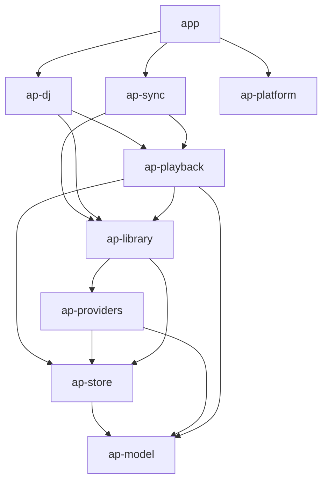

# Any Player Desktop v2 — Design

Status: **draft for review** · Branch: `rewrite/v2` (worktree `../any-player-desktop-v2`) · Lands as one cutover PR into `main`.

This document is the implementation source for the desktop rewrite. It was derived from a CodeGraph analysis of the
current Tauri/React app (`src/`, `src-tauri/src/`, `../any-player-shared-rust/crates/any_player_core`) and of the
Kotlin Android v2 app (`../any-player-android`, see its `docs/ARCHITECTURE.md`). Where this document and the Android
architecture describe the same behavior, the Android behavior is the reference unless a row in §15 says otherwise.

---

## 1. Goals and non-goals

**Goals**

- Native (non-web) cross-platform desktop app for Linux, Windows and macOS. No Electron, Tauri, webview, or HTML UI.
- Feature parity with Android v2 **minus on-device LLM/TTS**:
  - Spotify playback by **Spotify Connect remote control only**. The app drives a Spotify client (desktop app or web
    player) on this machine or elsewhere. It never decodes Spotify audio.
  - Jellyfin and Plex stream and decode locally.
  - One shared queue across sources: shuffle/repeat, play-next, distinct playback.
  - STANDARD and UNION custom playlists, search, and provider catalogs with an offline cache.
  - Full sync with the sync server: four namespaces, three-way merge, realtime WebSocket.
  - State transfer (`any-player-state`, optionally encrypted) and config-file import/export.
  - **Remote** AI DJ breaks via `/v1/dj-breaks` + `/v1/dj-passages`.
- OS media controls (MPRIS / Windows SMTC / macOS Now Playing + media keys), system tray, and close-to-tray.
- **Upgrade in place** for existing desktop installs: same DB file, keyring entries, data/cache directories and
  bundle identifier (§11).
- Byte-compatible wire and file formats with Android (§10).

**Non-goals**

- On-device LLM/TTS, model/voice downloads.
- Local Spotify decoding (librespot).
- Auto-update.
- Code signing and notarization. CI produces unsigned bundles only.
- Server protocol changes.
- A provider catalog tree in the OS media controls.
- Migrating sync settings out of the old webview `localStorage`; users re-enter them once (§11.4).

## 2. Key decisions

| # | Decision | Rationale |
|---|---|---|
| D1 | **Rust + Slint** (Slint royalty-free license; app stays Apache-2.0) | Chosen by owner. Native rendering, no webview, single binary. Attribution: `AboutSlint` in Settings → About. |
| D2 | **Absorb `any_player_core` into this repo's Cargo workspace**, rewritten to v2 contracts; archive `any-player-shared-rust` after cutover | Desktop is its last consumer; removes the cross-repo CI checkout. |
| D3 | No code sharing with Android (different stacks). Share **golden fixtures** instead: `fixtures/` in this repo, byte-identical copies of Android's test resources plus new vectors (§13.2) | Keeps the two implementations provably interoperable. |
| D4 | Port Android's architecture concepts 1:1: app-owned queue with stable occurrence `uid`, run planning, a level-triggered engine reconciler, and backends that play bounded runs | These are already tested and fix the legacy desktop's queue and repeat bugs (§15). |
| D5 | **Local audio = `symphonia` decode → `rubato` resample → `cpal` output** on a dedicated audio thread, with HTTP range streaming and a disk LRU cache | Pure Rust with no runtime to bundle. Seeks, reports real positions, detects real end-of-stream, and plays gaplessly within a run. |
| D6 | **Async runtime `tokio`; HTTP `reqwest` (rustls); WebSocket `tokio-tungstenite`** | Already used. Mature. |
| D7 | **SQLite via `rusqlite` (bundled)**. One writer connection on a dedicated DB thread; migrations are versioned by `PRAGMA user_version`; `foreign_keys=ON`, WAL | Fixes the legacy DB's missing transactions, foreign keys and versioning. |
| D8 | **Secrets in the OS keyring** (`keyring` crate, service `any-player`). Non-secret settings live in a DB `settings` table | Same keyring entries as legacy (§11.2). |
| D9 | No local WebSocket or IPC bridge. The UI talks to services in-process through typed handles and observable state | Removes the legacy 127.0.0.1:8990 WS server and the frontend-driven auto-advance. |
| D10 | Spotify OAuth: same client id `243bb6667db04143b6586d8598aed48b` and loopback redirect `http://127.0.0.1:8989/login`. PKCE S256 with a `state` check and proper URL decoding; Android's scope set | Requires no dashboard change. |
| D11 | Media controls: `souvlaki`. Tray: `tray-icon` (Windows/macOS) and `ksni` (Linux, StatusNotifierItem over D-Bus, no GTK) | Mature crates; avoids running a GTK main loop next to Slint on Linux. |
| D12 | Single instance per user (lock + local socket); a second launch focuses the existing window | Needed for tray mode and the fixed OAuth port. |
| D13 | Paused restore: restoring never starts audio or takes over a Spotify device until the user presses Play | Android D13 parity. |

## 3. Workspace layout

```text
any-player-desktop/
├── Cargo.toml                 # [workspace]; shared lints, profile, deps
├── crates/
│   ├── ap-model/              # pure: no IO, no async runtime
│   ├── ap-store/              # SQLite, migrations, keyring, settings, paths
│   ├── ap-providers/          # Jellyfin, Plex, Spotify Web API clients, auth, retry
│   ├── ap-library/            # catalog cache repo, playlist repo, transfer/config import-export
│   ├── ap-playback/           # engine, local backend (audio), Spotify Connect backend, persistence
│   ├── ap-sync/               # sync client + engine
│   ├── ap-dj/                 # remote DJ: schedule coordinator, passages, VoiceProcessor
│   └── ap-platform/           # media controls, tray, single-instance, OAuth loopback, Spotify launcher
├── app/                       # binary `any-player`: Slint UI, view models, startup wiring
│   ├── ui/*.slint
│   └── src/
├── fixtures/                  # cross-platform golden vectors (§13.2)
└── docs/DESIGN.md
```



Rules:

- `ap-model` has no IO. Every other crate depends on it.
- UI code (`app`) consumes service handles and state snapshots. It never touches SQL, `reqwest`, or audio types.
- Every service exposes `tokio::sync::watch` (state) and `broadcast` (events) receivers. Mutable state stays private.
- Deleted outright:
  - `src/`, `src-tauri/`, `package.json`, `pnpm-*`, `vite.config.ts`, `eslint.config.js`, `tsconfig*.json`, `index.html`, `public/`
  - the WebSocket server and the frontend cache blobs.

## 4. Threading model

| Work | Context |
|---|---|
| Slint UI, view-model state application | Main thread (Slint event loop). Services post updates with `slint::invoke_from_event_loop` / `Weak::upgrade_in_event_loop` |
| Network, sync, providers, orchestration | `tokio` multi-thread runtime (started before Slint, owned by `app`) |
| Playback engine | One tokio task (actor). Commands arrive on an `mpsc`; a single reconcile loop runs, woken through a conflated `Notify` |
| Spotify backend | One tokio task serializing commands and polls (Android parity) |
| Local audio decode | One OS thread per active decoder (symphonia + resampler), writing into an `rtrb` SPSC ring |
| Audio output | `cpal` callback thread: drains the ring, applies volume, and never blocks or allocates |
| SQLite | Dedicated DB thread owning the writer connection. Calls are async through a channel. Reads use a small pool of read-only connections (WAL) |
| Dedupe and large list transforms (≥1k rows) | `tokio::task::spawn_blocking` |
| DJ scheduling | One tokio task (actor). WAV DSP (`VoiceProcessor`) runs in `spawn_blocking` |

Position display follows Android: the engine publishes a `(position_ms, at_instant, rate)` anchor, and only the
visible progress widgets tick, on a 250 ms Slint `Timer`. The engine never republishes state just because position moved.

## 5. Domain model (`ap-model`)

These are Rust ports of Android `:core:model`. Serde shapes must match Android's kotlinx output exactly (§10.1).

- `SourceType { Spotify, Jellyfin, Plex, Custom, All }`. Serialized lowercase. Database columns use their legacy
  representation (§11.1).
- `Track`:
  - Fields: `id`, `title`, `artist`, `album?`, `duration_ms?`, `source`, `url?`, `image_url?`, `bitrate_kbps?`,
    `sample_rate_hz?`, `enriched?`, `is_dj_filler` (default false).
  - JSON keys are camelCase (`durationMs`, `imageUrl`, `bitrateKbps`, `sampleRateHz`, `isDjFiller`) to match Android.
  - Deserialization accepts aliases (`duration_ms`, `duration`, `image_url`, `bitrate_kbps`, `sample_rate_hz`) and
    PascalCase sources (`"Spotify"`), so payloads written by the legacy desktop and the legacy state file decode.
- `QueueEntry { uid: u64, track }`.
- `QueueState { entries, order: Vec<usize>, cursor: isize, shuffle, repeat, play_next_offset, content_version, next_uid }`
  with accessors `current`, `entry_at`, `upcoming`, `history`, `order_pos_of_uid`.
- `QueueOps` (pure; takes `&mut impl Rng`). Semantics are identical to Android §4.1:
  - `replace(tracks, start, random_start)`.
  - `play_next`: stacks after the current entry in both insertion order and play order.
  - `advance`, `back`, `jump_to_uid`.
  - `set_shuffle`: preserves the current entry and its history; disabling restores insertion order.
  - Only changes to entries or order bump `content_version`.
  - Repeat ALL wraps. Repeat ONE is delegated to the backend.
  - Previous: seeks to 0 when position > 3000 ms, otherwise moves back.
- Run planning:
  - `backend_for(track)`:
    - SPOTIFY when the normalized id matches `^[A-Za-z0-9]{22}$`.
    - LOCAL for `http`, `https` or `file` URLs.
    - Otherwise UNPLAYABLE.
  - `plan_run(state, from_order_pos, pending_break, max_items=50)` follows Android §4.2. Runs never wrap and never mix backends.
  - `PlanItem::{Song{uid, order_pos}, Break{break_id, path}}`. A `PendingBreak` is spliced into LOCAL runs. A Spotify
    run stops before it, and a single-item break run plays at the boundary.
- `dedupe`:
  - Key: `trim().to_lowercase()` of title and of artist, joined with `|`.
  - Keeps the first occurrence and reports duplicate groups.
  - Must pass `fixtures/dedup_spec.json`.
- `volume_normalization`:
  - `TARGET = 85`. Spotify output = `round(base * 85 / 100)`.
  - Other sources = `round(base * OTHER_SOURCE_FACTOR)`, where `target_rms = 0.04 + 0.85*0.18` and the factor is
    `clamp(target_rms / 0.22, 0.1, 1.0)` (≈ 0.877).
  - Computed in `f32` for Android parity; must pass the 0..=100 parity vectors.
  - Plus a **desktop-only per-track gain** for local sources (§8.4). It is not part of any wire format.
- `break_schedule::reduce`, a port of the Android §8.1 reducer:
  - The interval is random in [3, 5] and resets to 3 after a failure.
  - `songs_away` counts intervening real songs.
  - A one-song backward bounce keeps the furthest anchor.
- `signatures` (§9.4) and the wire DTOs for sync, state transfer and config files (§10).

## 6. Data layer

### 6.1 Paths (`ap-store::paths`)

All paths come from `dirs` and are unchanged from legacy:

- `data_dir()/any-player/`: Linux `~/.local/share/any-player`, macOS `~/Library/Application Support/any-player`,
  Windows `%APPDATA%\any-player`.
  - `playlists.db` (main DB)
  - `logs/` (rolling `tracing` files, 7 days)
  - `dj_filler/<breakId>.wav`
  - `instance.lock`
- `cache_dir()/any-player/audio_cache/` (LRU, 500 MiB) and `cache_dir()/any-player/images/` (LRU, 100 MiB).

### 6.2 SQLite schema (`playlists.db`)

Version 1 is the legacy schema (`user_version` 0). Migrations run inside one transaction per step on the DB thread
before any service starts. A failed migration aborts startup with a dialog; there is never a destructive fallback.

**Migration 0 → 1 (legacy → v2 baseline)**

1. `PRAGMA foreign_keys=OFF`.
2. Run the legacy ad-hoc column checks: add `playlist_type` and `is_distinct` if missing.
3. Delete orphans in `playlist_tracks` and `union_playlist_sources` (the legacy app never enabled foreign keys).
4. Recompute `custom_playlists.track_count` for STANDARD playlists.
5. Re-number positions densely (0..n) per playlist.
6. Create the new tables listed below.
7. `PRAGMA user_version=1`, then `foreign_keys=ON`.

Legacy tables keep their names and columns:

- `custom_playlists`
- `provider_playlist_preferences`
- `playlist_tracks` (row id stays `INTEGER AUTOINCREMENT`)
- `union_playlist_sources`
- `column_preferences`

Timestamps stay **epoch seconds** (legacy and wire format). Source strings stay lowercase.

New tables:

```sql
CREATE TABLE settings (key TEXT PRIMARY KEY, value TEXT NOT NULL);           -- JSON values
CREATE TABLE queue_entries (uid INTEGER PRIMARY KEY, seq INTEGER NOT NULL, track_json TEXT NOT NULL);
CREATE TABLE queue_meta (id INTEGER PRIMARY KEY CHECK (id = 0), order_uids TEXT NOT NULL,
                         cursor_uid INTEGER, content_version INTEGER NOT NULL);
CREATE TABLE cached_playlists (source TEXT NOT NULL, id TEXT NOT NULL, name TEXT NOT NULL, owner TEXT NOT NULL,
                               description TEXT, image_url TEXT, track_count INTEGER NOT NULL,
                               sort_index INTEGER NOT NULL, fetched_at_ms INTEGER NOT NULL,
                               PRIMARY KEY (source, id));
CREATE TABLE cached_track_owners (owner_key TEXT PRIMARY KEY, updated_at_ms INTEGER NOT NULL, track_count INTEGER NOT NULL);
CREATE TABLE cached_tracks (owner_key TEXT NOT NULL REFERENCES cached_track_owners(owner_key) ON DELETE CASCADE,
                            position INTEGER NOT NULL, track_json TEXT NOT NULL, PRIMARY KEY (owner_key, position));
CREATE TABLE sync_base (domain TEXT NOT NULL, target TEXT NOT NULL, remote_sig TEXT NOT NULL, local_sig TEXT NOT NULL,
                        PRIMARY KEY (domain));                                  -- one agreed target per domain
CREATE TABLE sync_version (target TEXT PRIMARY KEY, version INTEGER NOT NULL);
CREATE TABLE dj_passage_state (account_key TEXT PRIMARY KEY, state_json TEXT NOT NULL);
CREATE TABLE track_gain (track_key TEXT PRIMARY KEY, gain REAL NOT NULL, analyzed_at_ms INTEGER NOT NULL);
```

`owner_key` is `p:<source>:<id>` for a provider playlist and `u:<id>` for a union playlist (Android parity).

`track_json` never stores auth headers or tokens:

- Jellyfin auth travels in headers that are added at request time.
- Plex `X-Plex-Token` is stripped from `url` and `image_url` before persisting and re-added when the request is made.

**Write rules**

- Every multi-statement mutation is a single transaction.
- STANDARD append: `position = COALESCE(MAX(position) + 1, 0)` inside the transaction, together with `track_count`
  and `updated_at`.
- Remove and reorder: shift positions in the same transaction; the target position is clamped to `0..len-1`.
- Upserts use `INSERT … ON CONFLICT DO UPDATE`, never `REPLACE`, so row ids and cascades survive.

### 6.3 Settings keys (`settings` table)

| Key | Type / default | Notes |
|---|---|---|
| `player.volume` | int 50 | |
| `player.shuffle` / `player.repeat` | false / `"off"` | |
| `player.position_ms` | int | Checkpoint every 15 s while playing, plus on pause, seek and quit |
| `player.normalization_enabled` | false | |
| `player.normalization_strict` | false | **Not shown in the UI.** Stored only so the sync `settings` namespace round-trips Android's key unchanged (§9.5) |
| `dj.enabled` / `dj.show_entries_in_queue` | false / false | |
| `dj.voice_id` | null | Selected voice from the server catalog |
| `dj.voice_level` | 1.0 (0.5–2.0) | |
| `dj.debug_logging` | false | |
| `sync.server_target`, `sync.client_id` | `""`, generated `desktop-<uuid>` | |
| `sync.domains` | all true | `{app_state, playlists, provider_configuration, settings}` |
| `spotify.preferred_device` | null | `{id, name}` |
| `ui.close_to_tray` | true | |
| `ui.track_sort.<tableKey>` | null | `{column, ascending}` (formerly in localStorage) |
| `ui.window` | null | Window size and position |
| `providers.jellyfin.page_size`, `providers.plex.page_size` | 300 (1..=1000) | Now persisted; legacy forgot this value |
| `providers.jellyfin.user_id` | null | Resolved lazily, then persisted (Android parity) |
| `migration.*` | | One-shot flags (§11) |

### 6.4 Secrets (`ap-store::secrets`)

| Keyring account (service `any-player`) | Value |
|---|---|
| `spotify-token` | JSON `{access_token, expires_in, expires_at, refresh_token, scope}`: the legacy rspotify 0.16 `Token` shape, read and written unchanged. `scope` is a space-separated string and `expires_at` is RFC 3339 with nanoseconds |
| `jellyfin-url`, `jellyfin-api-key` | raw strings (legacy) |
| `plex-url`, `plex-token` | raw strings (legacy) |
| `sync-token` | **new**: sync bearer token |

- Secrets are loaded once on the IO runtime and exposed as in-memory state together with an `await_loaded()`.
- An empty initial snapshot does not mean "disconnected".
- A keyring failure (for example, no Secret Service on Linux) surfaces as a startup warning with Retry. The app then
  continues without the affected credentials and never falls back to plaintext.

## 7. Providers (`ap-providers`)

All clients share one `reqwest::Client` (rustls, connect timeout 10 s, request timeout 30 s; Plex keeps 6 s connect).

Retry policy is `execute_retrying`, a port of Android `retrying`:

- Retry 429 for any method, and 5xx only for GET/HEAD, up to 5 retries.
- Wait for a numeric `Retry-After` capped at 60 s, otherwise exponential `500ms << attempt` capped at 10 s.

`ProviderClient` trait: `source()`, `validate()`, `playlists()`, `playlist_tracks(id)`, `search_tracks(q)`,
`search_playlists(q)`, `stream_request(track) -> (Url, HeaderMap)`.

**Jellyfin**

- Headers: `X-Emby-Token`, and
  `X-Emby-Authorization: MediaBrowser Token="…", Client="AnyPlayer", Device="AnyPlayer", DeviceId="<install id>", Version="<app version>"`.
- `validate`: `GET /System/Info`, then `GET /Users`. The user is the stored `user_id`, otherwise the first user; the
  result is persisted (fixes the legacy behavior of re-resolving on every call).
- Playlists: `/Users/{uid}/Items?IncludeItemTypes=Playlist&Recursive=true`.
- Playlist tracks: paged `ParentId` reads with `Limit=page_size` and `StartIndex`. Stop on an empty page, a short page,
  or once `TotalRecordCount` is reached; at most 1000 pages.
- Search: tracks `Limit=50`, playlists `Limit=50`.
- Stream URL: `/Audio/{id}/universal?UserId=…&Container=mp3,aac,m4a,flac,ogg,wav&AudioCodec=aac,mp3,vorbis,flac&TranscodingContainer=mp3&TranscodingProtocol=http`.
  - The container and codec lists are restricted to formats symphonia decodes, so Opus/WebM sources are transcoded by
    the server (§8.3).
  - Auth goes in headers only.
- Image URLs carry `api_key` only at request time inside the image loader; it is never persisted.

**Plex**

- Header `X-Plex-Token` (not in the URL) and `Accept: application/json`.
- Endpoints: `/identity`, `/playlists/all?type=15`, and paged `/playlists/{id}/items` (`X-Plex-Container-Start` and `-Size`).
- Search: `/search?query=&limit=50`.
- Stream: `{base}{Media[0].Part[0].key}`. When `Media[0].audioCodec` is not supported locally (opus), use the universal
  transcode `/music/:/transcode/universal/start.mp3?path=/library/metadata/{id}&mediaIndex=0&partIndex=0&protocol=http&directPlay=0&directStream=0`.
- The legacy insecure-TLS fallback is kept, but only as an explicit per-connection setting "Allow self-signed
  certificate" that the user enables after a TLS failure. It is never silent.

**Spotify Web API**

- Scopes (Android's set): `playlist-read-private playlist-read-collaborative user-read-private user-read-email user-library-read user-read-playback-state user-modify-playback-state user-read-currently-playing`.
- PKCE S256 (§7.1).
- `SpotifyTokenProvider`:
  - Single-flight refresh that also runs when the token expires within 10 minutes.
  - Each 401 gets one forced refresh and a retry.
  - The token is persisted after every refresh, including at startup (fixes the legacy gap).
- Catalog:
  - `me/playlists` and `playlists/{id}/items`, paged with `limit=50/100` and `offset`. Episodes are skipped.
    - Spotify's February 2026 development-mode Web API changes removed `playlists/{id}/tracks`.
    - Each entry is read from `item`, falling back to `track`. The playlist count is `items.total`, falling back to
      `tracks.total`.
  - `search?type=track`: the maximum `limit` is now 10, so results are paged 10 × 5 to reach 50.
    **Playlist search** (`type=playlist`) is new; it was a legacy stub.
  - `/me` `product` may be absent, in which case premium status is unknown and is detected on the first
    `PREMIUM_REQUIRED` error.
  - Ids are normalized from `spotify:track:X`, URLs, and bare ids.

### 7.1 Spotify sign-in

1. Generate the verifier and `state`. Bind `127.0.0.1:8989` **only for this flow**. If the bind fails, show
   "Port 8989 is in use by another program." and the copyable URL.
2. Open the authorize URL with the `open` crate. The UI also shows the URL with a Copy button (parity with the legacy modal).
3. Callback:
   - Accept only `GET /login`.
   - URL-decode the query and check that `state` matches.
   - On `error=`, show an error page.
   - Respond with a small HTML page, then close the listener.
4. Timeout after 10 minutes, or cancel from the UI.
5. Exchange the code, persist the token, and refresh the catalog.

## 8. Playback (`ap-playback`)

### 8.1 Engine

This is a direct port of Android §6.1 / §12.2:

- **Public API (callable from any thread):** `set_queue(tracks, start, origin, autoplay)`, `play_next(tracks)`,
  `play`, `pause`, `toggle`, `next`, `previous`, `jump_to_uid`, `seek`, `set_volume`, `set_shuffle`, `set_repeat`,
  `set_normalization`, `set_pending_break`.
- **Observables:** `queue: watch<QueueState>`, `player: watch<PlayerState>`, `changes: broadcast<EngineChange{origin, content_changed}>`,
  `events: broadcast<EngineEvent>` (BreakStarted/Ended/Dropped, ItemStarted, Error), and `await_restored()`.
- **`ChangeOrigin::{User, Sync, Restore}`** travels on `changes`.
- **`PlayerState`:** status (Idle/Playing/Paused/Buffering/Error), `play_requested`, current uid, duration, position
  anchor, volume, normalization, error, `disabled_reason`, `active_break`.
- **Reconciliation:**
  - The desired state (plan, `play_when_ready`, seek request) is compared with each backend's applied state.
  - Every `load` carries a monotonically increasing `load_id`, and events carry `load_id` plus `ItemKey::{Song(uid), Break(id)}`.
  - Stale events are dropped, and in-flight commands are never cancelled.
  - On a backend switch, the old backend is stopped before the new one loads.
  - A pause that originates in the player (device removed, Spotify paused externally) is adopted into intent.
- **Run sliding:** each `ItemStarted` reconciles again. LOCAL runs extend upcoming items and keep at most 3 history items.
- **Playback gate:**
  - When the current track's provider is not connected, play is blocked from every entry point (UI, media controls,
    tray, sync), the engine auto-pauses once per track, and it exposes
    `disabled_reason = "Playback disabled: <Name> is not configured/authenticated for this app. Reconnect it in Settings. Next/Previous still works."`.
  - Next and Previous still work.
- **Persistence:**
  - Queue content is written 500 ms after a `content_version` change (debounced).
  - Cursor writes are qualified by version.
  - Flags and position go to `settings` (§6.3).
  - Restore stays paused and loads no backend; the first Play carries the saved position.
- **Auto-advance happens inside the engine** (the legacy frontend-driven `track-completed` → `next_track` path is gone).

### 8.2 Spotify Connect backend

This is a port of Android `SpotifyBackend`, `SpotifyPlayerApi` and `SpotifyDeviceResolver` (§6.2 / §12.3), adapted for desktop:

- **Loading a run:**
  - `PUT me/player/play {uris: run, offset: {position}, position_ms}` on the resolved device.
  - If the device already plays the target within 3000 ms (`ADOPT_TOLERANCE_MS`), adopt it.
  - Force remote `shuffle=false`. Remote repeat is `track` for ONE and `off` otherwise.
  - Never use `POST me/player/queue`.
- **Polling** runs only while a started run is held: 2000 ms while playing, 1000 ms near the end, 5000 ms while paused.
- **End detection:**
  - Settle window 3000 ms.
  - `RunEnded` arms only after `is_playing` was seen for the item.
  - Match on `item.id`, or on `item.linked_from.id` when present (Spotify may omit `linked_from` now).
  - An unknown id must be seen on 2 consecutive polls.
  - `STOPPED_AT_END_POLLS = 2`; end tolerance 700 ms; stall threshold 10 s; recovery attempts are bounded.
- **Boundary handling:**
  - At a Spotify→LOCAL or Spotify→break boundary, pause at `remaining - 300 ms` (`END_LEAD_MS`), force a poll, then
    emit `RunEnded`. This prevents Spotify Autoplay from bleeding into the next item.
  - Changes inside the loaded prefix trigger a run reload debounced by 300 ms. Volume writes are debounced by 300 ms.
- **Position:** re-anchor from polls only on drift > 750 ms, a play-state change, or a track change.
- **Device resolution** (single-flight; a resolved id is cached for its TTL):
  1. The preferred device from Settings, if online (match by id, else by name).
  2. The active device.
  3. **This computer**: a device whose name equals the hostname (case-insensitive), else the first device of type `Computer`.
  4. If the command is user-initiated (origin `User` and not restore/sync), launch the local Spotify client and wait
     5 × 1500 ms:
     - Windows: `cmd /C start "" spotify:`.
     - macOS: `open -a Spotify`.
     - Linux: the `spotify` binary, else `flatpak run com.spotify.Client`, else `xdg-open spotify:`.
  5. Any other controllable device.
- **Errors:** the legacy messages are kept:
  - `No active Spotify Connect device found. Open Spotify on this computer (or another device on the same account) and try again.`
  - `Spotify isn't installed. Install it, open it, and try again.`
  - `Premium required for full Spotify playback via Connect`
- About 20 s before a LOCAL→SPOTIFY boundary, the device is pre-resolved so the start is a single request.
- The Settings → Providers → Spotify panel lists the available devices with a "Use this device" action, which sets
  `spotify.preferred_device`.

### 8.3 Local audio backend

**Pipeline per item**

```text
HttpSource (range reads + read-ahead + disk cache) → symphonia FormatReader/Decoder
    → f32 interleaved → rubato resampler (to device rate, only when it differs) → rtrb ring (≈500 ms)
    → cpal output callback (volume × normalization factor, linear ramp 10 ms on changes)
```

**`HttpSource`** (`Read + Seek` for symphonia `MediaSourceStream`)

- Reads with HTTP Range requests (`bytes=a-b`, 256 KiB chunks) on its own blocking HTTP client in the decoder thread.
  Headers come from `stream_request`.
- Read-ahead keeps up to 2 MiB in memory.
- Fully downloaded files are kept in `audio_cache/` under the key `${SOURCE}:${trackId}` (sha256 filename). The cache
  is LRU with a 500 MiB limit, and its index lives in the cache directory.
- When the server ignores Range (no 206), the source falls back to sequential streaming and seeks forward by skipping.
- Prefetch: when the current item is within 30 s of its end, the next LOCAL item's first 1 MiB is fetched; the whole
  file is fetched if its known length is under 50 MiB.

**Formats**

- symphonia with features `mp3, aac, isomp4, alac, flac, vorbis, ogg, wav, pcm`.
- Opus is not supported by symphonia 0.5. Servers transcode it instead (Jellyfin through the codec list, Plex through
  the universal transcode; §7).
- Open item: decide on `symphonia-adapter-libopus` during implementation. It drops server transcoding for Opus at the
  cost of a C dependency.

**Gapless and run behavior**

- The decoder thread for item N+1 starts when item N's decoder hits EOF, and its frames are appended to the same ring.
  `ItemStarted(N+1)` fires when the output callback crosses the boundary marker.
- Repeat ONE re-opens the same item.

**Position and end of item**

- Position comes from samples consumed by the callback, not from the wall clock.
- Item end is the decoder's EOF, signalled once the ring drains past the marker. Duration comes from metadata when
  present, otherwise from the sample count at EOF.

**Per-track gain (desktop-only; see §8.4)**

- When normalization is on, the gain is applied in the output callback, multiplied with the volume factor.

**Errors**

- Network, HTTP or decode errors emit `Error(load_id, item, message)`. The engine marks the track and skips it
  (Android retry/skip parity) instead of reporting "playing" forever.

**Output device**

- The system default device is followed, and on a device change or loss the stream is rebuilt at the current
  position.
- An "Output device" picker lives in Settings → General.

### 8.4 Per-track loudness gain (desktop-only extra)

This keeps the legacy desktop feature. Android has no equivalent; the sync `settings` namespace still carries only
the shared enabled flag.

- **Applies to** every LOCAL item (Jellyfin and Plex; the legacy Plex skip is dropped) while normalization is
  enabled. Spotify items get only the volume factor. DJ breaks are already loudness-processed and get gain 1.0.
- **Analysis:**
  - Input: the first 6 s of decoded audio, all channels interleaved, as f32.
  - Fewer than 4096 samples, or RMS ≤ 0.0005 → gain 1.0.
  - `target_rms = 0.04 + 0.18 × 85/100`.
  - `gain = clamp(target_rms / rms, 0.4, 3.0)`, then `min(gain, 0.98 / peak)`, then `clamp(0.25, 3.0)`.
  - The same math as legacy `any_player_core` lives in `ap-model::volume_normalization::track_gain`. Unit tests pin it
    with vectors captured from the legacy implementation before it is deleted.
- **When it runs:**
  - The decoder thread holds a 6 s pre-roll buffer before it feeds the ring, so the gain is known before the first
    sample plays. This adds the fetch+decode time of 6 s of audio to a cold start.
  - For prefetched next items, analysis runs during prefetch, so the boundary adds no delay.
- **Cache:** `track_gain` table keyed by `${SOURCE}:${trackId}`. A cached value skips the pre-roll wait entirely.
- **Gain changes:** a 10 ms gain ramp is applied at item boundaries and whenever normalization is toggled
  mid-track. Toggling never restarts the item.

## 9. Sync (`ap-sync`)

This is an exact port of Android `SyncClient`, `DefaultSyncEngine` and `SyncBase`. Wire behavior must match so both
clients interoperate against the same account.

### 9.1 Client

- Base URL: `trim`, strip a trailing `/`, and add `https://` when no scheme is given.
- Token: `trim`, then strip a leading `Bearer\s+`.
- Header `Authorization: Bearer <token>`.
- HTTP calls:
  - `GET /v1/snapshot[?since_version=n]`. A 304 means no change.
  - `GET /v1/state/app-state` returns `{version, data}`, which is rewrapped as `{version, app_state: data}`.
  - `PUT /v1/state/{app-state|playlists|settings|provider-configuration}` with body `{client_id, data}`.
    `expected_version` is not sent (Android parity).
- WebSocket: `GET /v1/ws` with the Authorization **header** (no `?token=`). Only
  `{event_type:"state_updated", namespace, version, source_client_id}` messages are handled.
- Reconnect: backoff 1–60 s with jitter, reset only after a socket has stayed open for 30 s, and gated on network
  availability (an `if-addrs` change watcher plus a probe).

### 9.2 Engine behavior

The behavior follows Android §5.5 point by point:

- **Startup** (after the engine restores):
  - Pull a snapshot. On success the account becomes *confirmed*. If the pull fails, the target stays pending and is
    retried with backoff.
  - Startup applies playback only if local playback did not change during the fetch, and it never replaces playback
    that is already playing.
- **Connect** (Settings button):
  - Persist the target and token.
  - Take a snapshot. If the server already has data, set `conflict_pending` and show the choice dialog
    ("Server already has synced data - choose which side to keep."). Otherwise push local and confirm.
  - Cancel stops realtime updates and pushes until the next Connect or app start.
- **Pull** (Settings button): when local playlists exist and playlist sync is on, ask "Confirm playlist overwrite"
  with three choices: Continue / Keep this device's playlists / Cancel.
- **Pushes**:
  - App state:
    - Pushed only after a non-empty queue has been observed since restore.
    - Never for SYNC/RESTORE-origin changes.
    - Echo guard of 3.5 s.
    - Minimum interval of 2 s between pushes.
    - Discrete events only; no periodic or heartbeat pushes.
  - Playlists and settings are pushed when the local export differs from the domain's local base (coalesced ≥ 2 s).
    - A failed push retries with backoff and also on socket open.
    - Both paths fetch a snapshot and merge before pushing.
  - Provider configuration is pushed on Connect and whenever a provider's URL changes.
- **Realtime events:**
  - `app_state` events fetch `/v1/state/app-state`, falling back to the snapshot.
  - Other namespaces fetch the snapshot and apply only that namespace.
  - An event version below the cursor (server rollback), and every socket open, fetches the full snapshot.
  - A snapshot version below the recorded version clears all bases and resets the cursor to 0.

### 9.3 App-state payload

`{state: "playing"|"paused"|"stopped", shuffle, repeat_mode: "off"|"one"|"all", volume, position, duration, current_track?, queue?}`.

- `queue` is insertion order and is omitted when empty. `current_track` is omitted when there is none.
- Tracks use the Android JSON shape (§5).

Apply order: volume → shuffle → repeat → queue (replaced when the track list or current track differs; a current
track missing from the queue is prepended) → seek when |Δ| > 2500 ms → play/pause.

### 9.4 Signatures and bases

- `app_state_sig = sha256_hex(join("\0", [shuffle, repeat, "source:id" of current or "", …"source:id" of queue with
  current prepended if absent]))`.
  - `shuffle` is printed as `true`/`false`/`null` (Kotlin `toString`).
  - `source` is printed **uppercase** (Kotlin enum `toString`, e.g. `SPOTIFY`).
- `playlists_sig = sha256_hex(canonical(json))`:
  - Playlists are sorted by `playlist.id`.
  - Each playlist's `tracks` and `union_sources` are sorted by `position`, with their `id` removed.
  - Nulls are dropped, object keys sorted, and the result printed compactly with kotlinx's string escaping.
- `settings_sig = sha256_hex(canonical(settings_json))`.
- Base target = `normalized_url + "#" + sha256_hex(normalized_token)`.
- Store: `sync_base(domain)` keeps one agreed `(target, remote_sig, local_sig)` per domain (Android keeps one per
  domain too), plus `sync_version(target)`.
- All four signature functions must reproduce `fixtures/sync_signatures.json` (§13.2) byte-for-byte. Android's float
  and string encodings are the reference.

### 9.5 Namespaces

- **`settings`**:
  - Push `{audio_normalization_enabled, audio_normalization_strict_mode}`.
  - Read the snake_case keys or the camelCase fallbacks.
  - The strict flag is stored and re-emitted unchanged, and has no desktop UI.
- **`provider_configuration`**: `{jellyfin?: {base_url}, plex?: {base_url}}` with defaults omitted. Importing it merges
  base URLs only (never secrets); a changed URL revalidates and refreshes only that provider.
- **`playlists`**:
  - Format: the config-file `custom_playlists` array (§10.3).
  - Import uses REPLACE_ALL through the shared importer, with deterministic ids so a repeated pull is idempotent.
    (Legacy desktop regenerated UUIDs and re-prompted on every pull.)
  - Three-way merge, identical to Android `mergePlaylists`:
    - **CONFIRM** when local playlists exist, the remote is empty, and the remote changed since the base (or there is
      no base).
    - **No base:** equal signatures → **UNCHANGED** (record the base); local playlists exist → **CONFIRM**; otherwise
      → **APPLY_REMOTE**.
    - **Base exists:**
      - Remote unchanged → **PUSH_LOCAL** if local changed, else **UNCHANGED**.
      - Local unchanged → **APPLY_REMOTE**.
      - Both changed → **PUSH_LOCAL** when realtime, **CONFIRM** otherwise.
    - A CONFIRM during realtime pauses playlist sync with the status "Playlist sync paused: confirm in Settings".

## 10. File and wire formats

### 10.1 kotlinx-compatible serde (`ap-model::wire`)

Android encodes with `AppJson = Json { ignoreUnknownKeys = true; explicitNulls = false }`. In that encoding, fields
equal to their declared default are omitted (`encodeDefaults=false`) and so are nulls. The Rust rules that follow:

- Fields are declared in Kotlin declaration order, because the output order feeds the integrity hashes.
- Every field with a Kotlin default gets `#[serde(skip_serializing_if = "is_default")]`, with the same default value.
- Every optional field gets `skip_serializing_if = "Option::is_none"`.
- Unknown keys are ignored.
- Strings are escaped exactly like kotlinx: `serde_json` compact output matches for ASCII and for `\" \\ \n \r \t \b \f`.
  Control characters < 0x20 must use `\u00XX` with lowercase hex. A unit test pins the escaping table.

### 10.2 `any-player-state` transfer file

- **Envelope fields** (in this order): `format` (default `"any-player-state"`, omitted), `version` (default 1,
  omitted), `createdAt` (ISO-8601 instant), `sourceApp {platform:"desktop", appVersion}`, `data`, `integrity {sha256}`.
- **`data` fields:**
  - `customPlaylists[]`: `CustomPlaylist {id, name, description?, imageUrl?, createdAt, updatedAt, trackCount, playlistType, isDistinct=false}`.
  - `playlistTracks[]`: `{id, playlistId, trackSource, trackId, position, addedAt, title, artist, album?, durationMs?, imageUrl?, url?}`.
  - `unionPlaylistSources[]`.
  - `columnPreferences{}`.
  - `connections{SOURCE: ExportedConnection}`.
  - `playbackState?` (`PlaybackStatus`).
  - Timestamps here are ISO strings; they are converted from DB seconds.
- **Integrity:** `sha256_hex(compact_json(envelope with integrity.sha256 = ""))`. It must verify against
  `fixtures/legacy-state.json`.
- **Encryption** (PRIVATE mode):
  - `{format, encrypted:true, algorithm:"AES-256-GCM", kdf:"PBKDF2-HMAC-SHA256", kdfIterations:150000, saltBase64, nonceBase64, ciphertextBase64}`.
  - 16-byte salt, 12-byte nonce, 128-bit tag appended to the ciphertext (JCE layout), standard Base64.
  - Implemented with the `pbkdf2`, `aes-gcm` and `base64` crates.
- **Export modes:** PORTABLE (no secrets) and PRIVATE (Jellyfin/Plex tokens included; never Spotify).
- **Import policies:** `REPLACE_ALL`, `MERGE_KEEP_LOCAL`, `MERGE_PREFER_IMPORT`, plus dry run. The summary line uses
  the Android format: `"Import complete. playlists +A/~U, tracks +A/~U, union +A/~U, connections +I/skip S, <warnings>"`.
- REPLACE_ALL and MERGE_PREFER_IMPORT also apply the exported volume, shuffle and repeat through the engine.

### 10.3 Config file (`export_version` 1)

`{export_version:1, provider_configs:{spotify?{client_id,redirect_uri}, jellyfin?{base_url}, plex?{base_url}}, custom_playlists:[{playlist{…snake_case, created_at/updated_at seconds}, tracks[…], union_sources[…]}]}`.

- This is identical to the legacy desktop export, which is a superset of what Android reads.
- Export omits nulls and default-valued fields, the same as Android `syncJson` (`encodeDefaults=false`; verified by
  `fixtures/config_ids.json`).
- **Import is new on desktop.** It uses deterministic ids via a Rust port of Java `UUID.nameUUIDFromBytes` (MD5,
  version 3):
  - Tracks: `track:<playlistId>:<SOURCE>:<trackId>`, with a `:occurrence:<n>` suffix for repeats.
  - Union sources: `union:<unionId>:<SOURCE>:<sourcePlaylistId>`.
  - Import remap suffixes `_import_` / `_cfg_` follow the Android `PlaylistImporter`.

### 10.4 Golden-vector requirement

Every format in §10 has a fixture in `fixtures/`. CI fails if the Rust output differs.

## 11. Upgrade in place (from Tauri desktop 0.1.x)

### 11.1 Identity and locations

- Bundle identifier stays `rocks.nesbitt.any-player.app` (the macOS bundle id and Windows AppUserModelID, which SMTC requires).
- Product name `Any Player`; binary `any-player`.
- The DB, data, cache and keyring locations are unchanged (§6.1, §6.4).

### 11.2 First-run migration (each step guarded by a `migration.*` flag and idempotent)

1. DB `user_version` 0 → 1 (§6.2).
2. **`playback_state.json`** → queue tables and player settings:
   - Decode the legacy `PersistentPlaybackState` (PascalCase `Source`, `repeat_mode` `"Off"|"One"|"All"`).
   - Map it to `QueueState`:
     - entries = `queue`, in insertion order.
     - With `shuffle && !shuffle_order.is_empty()`, order = `shuffle_order` and the cursor equals `current_index` as an
       order position. Otherwise the cursor equals `current_index` directly.
     - Out-of-range values clamp, and an empty queue is ignored.
   - Copy volume, shuffle, repeat, position and normalization.
   - Commit, then rename the file to `playback_state.json.migrated-v2`.
3. Keyring entries are read in place and keep the same format. No migration is needed.
4. Legacy cache files are deleted from `cache_dir()/any-player/`:
   - `playlists_cache.json`, `custom_playlists_cache.json`
   - `custom_playlist_tracks_*`, `union_playlist_tracks_*`, `provider_playlist_*`
   - `track_metadata_spotify_*`
   - `$TMP/any-player-audio-*.mp3`
   The catalog cache is rebuilt from the network.
5. `config.toml` is left untouched and no longer read; it is unused in practice.
6. Old webview data under `rocks.nesbitt.any-player.app` (WebKitGTK/WebView2/WKWebView) is left alone. Sync settings
   are **re-entered once**. On first run, if no sync target is set, a dismissible banner says: "Sync settings didn't
   carry over from the previous version. Re-enter them in Settings → General."

### 11.3 Rollback

- v2 only adds tables and columns, plus `user_version`. The legacy Tauri app ignores both and keeps working on the same
  DB.
- The legacy app does not read the queue tables, so a downgrade loses only the queue, which falls back to the
  renamed state file if the user renames it back.

### 11.4 Not migrated

The localStorage sync settings, the sync client id (a new one is generated; the server treats it as a new client),
and the per-table sort state.

## 12. App and UI (`app`, Slint)

### 12.1 Structure

- One `MainWindow` (default 1100×720, minimum 800×560). Layout:
  - Left: sidebar navigation with Now Playing, Playlists, Search and Settings.
  - Center: the current page.
  - Bottom: the play bar, hidden on Now Playing.
- The startup banner and the toast area overlay the content.
- A view model per page lives in Rust (`app/src/vm/*.rs`):
  - Each one owns a Slint global or struct properties and subscribes to service receivers.
  - It builds immutable row models off-thread, then swaps them in with `VecModel::set_vec`.
  - Rows are keyed by occurrence (`uid_<n>`, or playlist row id) so duplicate tracks don't collide.
- Images:
  - An async loader with an LRU disk cache plus an in-memory `slint::Image` cache (200 entries).
  - Decoding uses the `image` crate in `spawn_blocking` and returns a `SharedPixelBuffer`.
  - Placeholder glyph on error, reset on every track change (fixes the legacy art bug).

### 12.2 Pages

Behavior and wording follow the Android screens. The legacy desktop texts are kept where Android has no equivalent.

| Page | Contents |
|---|---|
| **Now Playing** | Art, title/artist/album, source and quality indicators (Spotify tooltip as in legacy), disabled-reason banner, progress (seeks on release, not on every drag tick), transport (shuffle, previous, play/pause, next, repeat off→all→one), volume (50 ms debounce), Spotify device chip. Queue panel: Up Next (play order after the cursor), History, and an "AnyPlayer DJ" row inserted `songs_away` rows ahead with status (Not started / Processing / Ready for playback). Click → `jump_to_uid`; context menu → Play next |
| **Playlists** | Tabs All / Custom / Spotify / Jellyfin / Plex. Each tab filters the catalog DB (fixes the legacy shared-cache overwrite). Refresh, Create (Standard/Union picker that is actually honored). Cards show name, owner, track count and source |
| **Provider playlist detail** | Header, Distinct toggle, Play All, Refresh, track table, filter box, duplicates section (read-only), "Play from here", "Add to playlist…" |
| **Custom (STANDARD) detail** | Edit name/description, Delete (confirm), Distinct, Play All, track table with remove and reorder, duplicates section with Remove. Rows play by `track_id` (fixes the legacy row-id bug) |
| **Union editor** | Sources list with Add (source filter: All/Spotify/Jellyfin/Plex/Custom; excludes itself and other unions), Remove, reorder (up/down); combined tracks; Distinct honored by Play All (legacy bug) |
| **Search** | Query, Tracks/Playlists tabs, source filter All/Spotify/Jellyfin/Plex. Typed search is cancellable; partial provider failure keeps the results that succeeded and shows "Search failed" only if all fail. 20 rows per page. Track actions: Play, Play next, Add to playlist… (STANDARD only). Playlist results open the provider detail page |
| **Settings → General** | Sync server (URL, token field commits on Enter or focus loss; domain toggles; Connect, Pull, status line; conflict and overwrite dialogs), Playback (normalize across providers; output device), Transfer (export/import state with mode, passphrase, policy and dry run; export/import config), Clear provider cache, Track table columns, Window (close to tray), About (version, licenses, `AboutSlint`) |
| **Settings → Providers** | Spotify (connect/disconnect, login URL + Copy, devices list + preferred), Jellyfin and Plex (URL, secret with show/hide, page size, connect/disconnect, errors as in legacy, "Allow self-signed certificate") |
| **Settings → AI DJ** | Enable, show entries in queue, voice picker (server catalog `/v1/dj-voice-models`), voice level slider 0.5–2.0, preparation status, AI DJ Logs (enable debug logging, Clear, Copy). Without a sync server: "AI DJ needs a sync server configured in Settings → General." |

**Track table**

- Columns: `#`, Title, Artist, Album, Duration, Source, and Actions.
- Visibility and order come from `column_preferences`. Widths use the legacy keys; the `duration`/`duration_ms`
  mismatch is normalized to `duration`.
- Tri-state sort is persisted per table key.
- Reorder:
  - Drag handles via a `TouchArea`-based custom drag (Slint has no list DnD), plus Move up / Move down actions.
  - Reorder is disabled while the table is sorted or filtered (fixes the legacy filtered-reorder bug).
- Rows are virtualized (`ListView`), and the table must stay smooth at 10k rows.

**Keyboard shortcuts**

| Key | Action |
|---|---|
| Space | Play/pause (when focus is not in a text field) |
| Ctrl/Cmd+→ / ← | Next / previous |
| Ctrl/Cmd+F | Focus search |
| Ctrl/Cmd+, | Settings |
| Esc | Close a dialog |

**Accessibility:** every control sets `accessible-role` and `accessible-label`.

### 12.3 Startup (`app::startup`, Android §5.7 adapted)

1. Acquire the single-instance lock. If it is held, signal the running instance to show its window, then exit 0.
2. Initialize `tracing` and the paths, open the DB, and run migrations (§6.2, §11).
3. Start the tokio runtime and construct the services.
4. Engine restore (paused) and provider session restore run in parallel.
   - Each provider has a 10 s timeout. A failure becomes a `StartupStatus` warning with a Retry button that reruns
     only that step.
   - A "Continue without services" action is available.
5. Show the window, unless launched with `--minimized` (autostart), in which case only the tray is shown.
6. After the window is first shown or playback starts:
   - Construct the DJ coordinator.
   - Refresh catalogs (stale-while-revalidate, 6 h; 4 concurrent track fetches).
   - Start sync (startup pull and realtime).

### 12.4 Desktop integration (`ap-platform`)

- **Media controls (`souvlaki`):**
  - Metadata: title, artist, album, art URL (or a cached file URL on Windows), and duration.
  - Playback state and position.
  - Commands: play, pause, toggle, next, previous, seek, set position, and volume (MPRIS). All route to the engine
    with origin `User`.
  - The Windows HWND comes from the Slint window through `raw-window-handle`.
  - The DJ break shows as "AnyPlayer DJ".
- **Tray:**
  - Menu: Show/Hide, Play/Pause, Next, Previous, separator, Quit.
  - Tooltip shows the current track. Left click toggles the window.
  - Closing the window hides it to the tray when `ui.close_to_tray` is on (default). The first time, a notification
    says "Any Player is still running in the tray."
  - Quit saves state and exits.
  - Windows/macOS use `tray-icon`, created on the main thread after the Slint event loop starts. Linux uses `ksni` on a
    tokio task.
  - If no tray host is available (some GNOME setups without the AppIndicator extension), close-to-tray is disabled
    with a Settings note and closing quits.
- **OAuth listener and Spotify launcher:** §7.1 and §8.2.

## 13. Testing and verification

### 13.1 Suites (`cargo test --workspace`)

- **`ap-model`:** queue ops, run planning, shuffle invariants (property tests with `proptest`), break schedule,
  normalization parity, dedupe spec, signatures, wire round-trips.
- **`ap-store`:**
  - Migrations from a checked-in **legacy `playlists.db` fixture** (built from the legacy schema with orphans, gaps and
    duplicate rows).
  - Transactions; the keyring through a mock credential builder.
- **`ap-providers`:** `wiremock` servers for Jellyfin, Plex and Spotify covering paging, retry/Retry-After, 401
  refresh, header auth and URL stripping.
- **`ap-library`:** catalog refresh (vanished playlists removed in the same transaction), union materialization
  (nested custom one level deep, `(source,id)` identity dedupe, bounded parallel fetch preserving order), and
  transfer/config import-export against fixtures.
- **`ap-playback`:**
  - Engine with fake backends: stale load ids, backend switching, gate, paused restore, break delivery rules.
  - Local backend: a decoder over generated WAV/FLAC/MP3 fixtures served by a local HTTP server, covering range,
    no-range, seek, EOF, gapless boundary, and error→skip. The output uses a null sink so CI needs no audio device.
  - Spotify backend: fake `SpotifyPlayerApi` with scripted polls covering adopt, settle, relink, unknown-id ×2,
    end-lead pause, and stall.
- **`ap-sync`:** port of Android `DefaultSyncEngineTest` scenarios against an in-process fake sync server: merge
  matrix, echo guard, rollback, conflict/cancel, startup-unchanged rule, reconnect backoff.
- **`ap-dj`:** reducer, passage budget/exclusion, receipts cap 512, VoiceProcessor loudness within ±0.5 LU of
  −14 LUFS on fixture speech.
- **`app`:** view-model unit tests, plus UI smoke tests using Slint's testing backend (`i-slint-backend-testing`):
  navigate every page, drive a fake engine, and assert the visible text.

### 13.2 Cross-platform fixtures (`fixtures/`)

- Copied byte-identical from Android: `dedup_spec.json` and `legacy-state.json`.
- New vectors, generated once **from the Android implementation** by a small JVM test added to the Android repo that
  writes them, and committed to both repos:
  - `sync_signatures.json`: app-state, playlists and settings signatures for representative payloads, including
    unicode, nulls and duplicates.
  - `state_transfer_portable.json` and `state_transfer_private.json` (with passphrase), plus the expected import
    summaries.
  - `config_import_ids.json` (nameUUIDFromBytes vectors).
  - `volume_normalization.json` (0..=100 for each source).
  - `break_schedule.json` (event sequences → expected `songs_away` and target).

### 13.3 CI (`.github/workflows/build-test.yml`, rewritten)

- `fmt` and `clippy -D warnings` on Linux.
- `cargo test --workspace` on Linux, Windows and macOS.
- Bundles via `cargo-packager`, unsigned:
  - deb and AppImage on Linux (`ubuntu-22.04`, needs `libasound2-dev`, `libdbus-1-dev`, `libxkbcommon-dev`,
    `libfontconfig1-dev`).
  - msi and nsis on Windows.
  - dmg and .app on macOS.
- Bundles are uploaded as artifacts.
- The shared-rust checkout and every Node step are removed.

### 13.4 Manual verification before cutover

- Upgrade an existing Tauri install on each OS: playlists, credentials and queue are present, and restore is paused.
- Mixed queue Jellyfin → Spotify → Plex with shuffle and repeat ALL. Spotify on a local desktop client and on a web
  player; no Autoplay bleed at the boundaries.
- Media keys and OS media overlay on each OS. Tray hide/show/quit.
- Sync against a live server with the Android app on the same account: playlist edit round-trip, conflict dialog,
  realtime playback handoff, server rollback.
- State file exported on Android imports on desktop (and the reverse), PORTABLE and PRIVATE.
- Remote DJ break plays between songs; Previous during a break restarts the previous song; Next skips the break.

## 14. Remote AI DJ (`ap-dj`)

This is a port of the Android remote path (Android §8, excluding on-device generation):

- **Account:** the committed sync base URL and token (never an uncommitted draft). With no account, DJ is idle and its
  status says so.
- **Passages:**
  - `GET /v1/dj-passages?song=&artist=[&album=]`.
  - Call timeout 5 s. Retry on 503 up to 2 times with a 250 ms × 2ⁿ delay.
  - Response `{status:"ok", passages:[{chunk_id, text, source, source_url, title, subject, lang}]}`.
  - Passages played within 30 days are excluded, then the list is fitted to a token budget of 2500
    (`estimate_tokens = (latin+2)/3 + non_latin`).
  - Receipts `POST /v1/dj-passages/played {event_id, played_at, chunk_ids}` are queued (cap 512, oldest dropped) and
    flushed in the background.
  - State is kept in `dj_passage_state` keyed by `sha256(base + "\0" + token)`.
- **Generation:**
  - `POST /v1/dj-breaks {title, artist, passages:[{chunk_id, text, source}], voice_id?}` with a read timeout of 5 min
    and a call timeout of 6 min.
  - 200 returns a WAV body. 204 means the script was rejected (logged; no break this time).
  - Other statuses log Android's `describeFailure` text:
    - 404 → "This sync server doesn't have AI DJ break generation configured yet. Ask the server admin."
    - 401/403 → the token was rejected.
    - Anything else → `HTTP n`.
- **Post-processing:** the WAV is decoded with `hound`, run through a port of `VoiceProcessor`, and written to
  `dj_filler/<breakId>.wav`. The processing chain:
  - Trim at −50 dB with a 20 ms margin.
  - EQ: HPF 80 Hz, low shelf 150 Hz +1.5 dB, peak 300 Hz −2.5 dB, peak 3.5 kHz +3 dB, high shelf 8 kHz +2 dB when fs > 20 kHz.
  - Compressor −20 dB, 3:1, 6 dB knee, 5/120 ms.
  - Three passes of BS.1770 loudness to −14 LUFS + 20·log10(level), each followed by a −1 dBFS lookahead limiter
    (3 ms lookahead, 80 ms release).
  - Pad 50/200 ms with fades of 10/40 ms.
- **Coordinator:** an actor following Android §8.2:
  - Breaks play only on *advance* into the target, never on a jump.
  - During a break the cursor stays on the previous song. Previous cancels the break and restarts that song; Next
    skips the break.
  - `BreakStarted` marks the break active.
  - Files of active breaks live until `BreakEnded`. Only never-started breaks are deleted on `BreakDropped`.
  - The finished-audio cache holds 3 entries keyed by track id plus chunk ids.
  - Startup sweeps orphan files.
- **Diagnostics:** an in-memory ring of 200 entries backs the AI DJ Logs panel.

## 15. Behavior changes vs. legacy desktop

| Legacy behavior (from analysis) | v2 |
|---|---|
| Repeat stored but never applied; queue never wraps | Repeat OFF/ALL/ONE as in Android |
| Toggling shuffle resets the index to 0; later-queued tracks are invisible in shuffle | `QueueOps::set_shuffle` keeps the current entry; `play_next` inserts into both orders |
| `play_track` leaves an empty queue; cursor re-sync matches by id only | Queue occurrences with uid; play-from-here builds a real queue |
| Whole-file download before playback; wall-clock position; seek no-op; no end for unknown durations; silent errors | Range streaming, sample-accurate position, real seek, EOF-based end, error → skip |
| Auto-advance driven by the webview | Engine-internal |
| Global playback mutex held across Spotify device waits | Actor plus serialized backend; the UI never blocks |
| Spotify end detection by 2 stopped polls; Autoplay bleed; poller runs for the app's lifetime | Android run-based Connect backend; polls only while a run is held |
| Spotify may take over any idle device; switching to a local track pauses any client on the account | Preferred → active → this computer → launch → any. Local switch pauses only a device this app started |
| Per-track RMS gain analysis for Jellyfin (normalization on) | **Kept** as a desktop-only extra (§8.4). Now applied to all local sources and cached per track |
| Sync: app_state pushed every 2 s with a 15 s heartbeat; playlists pull-only with regenerated ids → re-prompt on every pull | Android sync engine: discrete pushes, three-way merge, deterministic ids |
| `?token=` WebSocket auth | Authorization header |
| No import of config/state; unencrypted export only | Full Android transfer: state file (portable/private) and config import/export |
| No foreign keys, no transactions, orphans, unversioned migrations | Transactions, foreign keys, `user_version` migrations, orphan cleanup |
| Frontend cache blobs (double-encoded JSON, unsanitized filenames) | Normalized catalog cache tables |
| OAuth listener always on; no `state` check; 13 scopes | Listener bound per flow; PKCE + `state`; 8 scopes |
| Local WS server on 8990 | Removed |
| "Enable Autoplay" checkbox (stub), "+ Add Track" help panel (stub) | Removed; "Add to playlist…" from search and provider detail |
| Spotify playlist search missing; `get_playlists` stub | Implemented / removed |
| Jellyfin user re-resolved every call; first user silently | Persisted `user_id` |
| Plex token embedded in persisted URLs | Header auth; tokens stripped at persist |

## 16. Implementation plan (build order)

Each milestone ends green on `cargo test --workspace` and `clippy`.

1. **Workspace and model:** the workspace skeleton and `ap-model` complete with fixtures (Android vectors generated
   first, §13.2).
2. **Store:** `ap-store` with migrations against the legacy DB fixture, settings, and secrets.
3. **Providers:** `ap-providers` (three clients, Spotify auth plus the loopback listener in `ap-platform`).
4. **Library:** `ap-library`: catalog cache, playlists (STANDARD/UNION/distinct), transfer and config files.
5. **Engine:** `ap-playback` engine with fake backends, then the local audio backend, then the Spotify backend;
   persistence and legacy state migration.
6. **UI and platform:** the `app` shell (Slint pages and view models), startup, tray, media controls, single instance.
   **First runnable build.**
7. **Sync:** `ap-sync`, with interop checked against a live server and Android.
8. **DJ:** `ap-dj` (remote) and its UI.
9. **Release prep:** CI rewrite and packaging, manual verification (§13.4), README/CONTRIBUTING rewrite, and deletion
   of the Tauri/React tree. Cutover PR `rewrite/v2` → `main`.
10. **After merge:** archive `any-player-shared-rust`, and update `any-player-sync-server/docs/app-integration.md`
    (header WebSocket auth, desktop is a full client).

## 17. Risks and open items

| Risk / item | Mitigation |
|---|---|
| Slint list DnD and complex tables are less turnkey than web | Custom `TouchArea` drag plus Move up/down; a performance budget of 10k rows checked in the UI smoke test |
| Opus unsupported in symphonia | Server transcoding (§7); decide on `symphonia-adapter-libopus` during M5 |
| Linux tray availability (GNOME) | `ksni`; detect when no tray host exists and disable close-to-tray |
| Linux keyring without Secret Service (headless/minimal WMs) | Startup warning with guidance; no plaintext fallback |
| Byte-exact kotlinx JSON emulation | Golden fixtures generated from Android; escaping table test |
| Spotify device naming on desktop clients may not equal the hostname | Fall back to type `Computer`; explicit preferred-device picker |
| Per-track gain adds cold-start latency (6 s pre-roll) | Gain cache; prefetch-time analysis for the next item |
| macOS media keys require a signed app for some integrations | Validate unsigned behavior in §13.4; document it |
